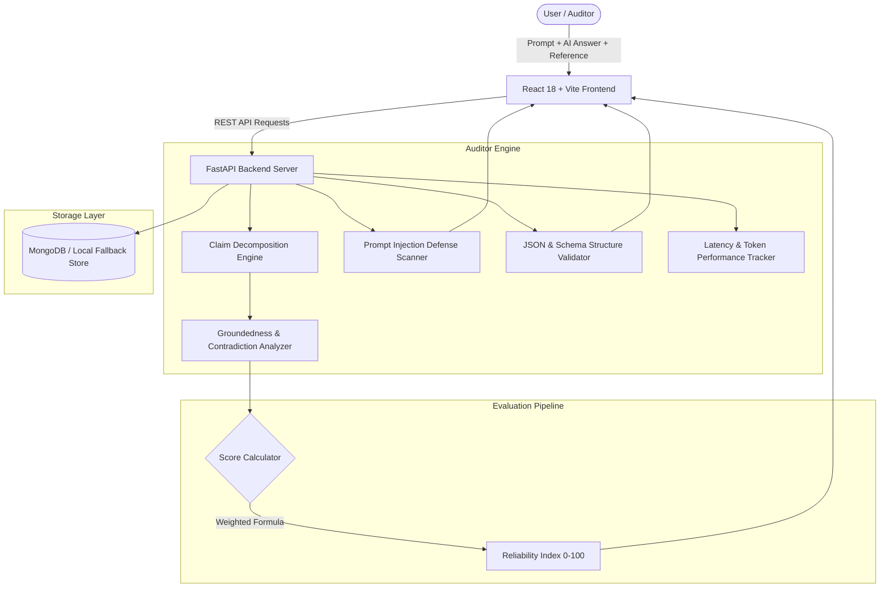

# TrustLens AI – Intelligent AI Response Reliability Auditor

> **Academic Level:** Undergraduate Mini-Project (Electronics & Communication Engineering / Computer Science)  
> **Author:** Second-Year Engineering Project  
> **Topic:** Generative AI Quality Assurance, Grounding Verification, Hallucination Auditing, and Input Defense  

---

## 1. Project Overview

**TrustLens AI** is a full-stack automated quality auditor for Large Language Model (LLM) responses. When deploying AI models in high-reliability domains (education, healthcare, customer support, legal), hallucinations, conflicting factual assertions, and prompt injection vulnerabilities pose critical risks.

TrustLens AI evaluates generated responses against reference ground-truth documents, divides the response into atomic factual claims, classifies claim groundedness, calculates an objective reliability score out of 100, and performs defensive prompt injection audits and JSON schema validation.

> **System Scope & Capability Notice:**  
> TrustLens AI provides groundedness verification and inconsistency detection against user-provided reference documents. It does not claim to detect every conceivable hallucination or guarantee absolute ontological truth.

---

## 2. Architecture & Pipeline



---

## 3. Technology Stack

| Component | Technology | Version | Purpose |
| :--- | :--- | :--- | :--- |
| **Frontend** | React.js | 18.3.1 | Dynamic component-driven user interface |
| **Build Tool** | Vite | 5.2.11 | Fast HMR development and optimized bundling |
| **Styling** | Tailwind CSS | 3.4.3 | Responsive modern SaaS dark-mode UI |
| **Icons** | Lucide React | 0.363.0 | Modern SVG iconography |
| **Charts** | Recharts | 2.12.7 | Visual score distributions and comparison charts |
| **Backend** | Python / FastAPI | 3.14 / 0.162 | High-performance asynchronous REST API |
| **Data Validation**| Pydantic v2 | 2.14.3 | Schema validation and response serialization |
| **Server** | Uvicorn | 0.54.0 | ASGI web server for Python |
| **Database** | MongoDB / Motor | 7.0 / 3.7.1 | Persistent storage with zero-friction local fallback |
| **AI Integration** | Google Gemini / OpenAI | Optional | LLM semantic comparison with rule-based fallback |
| **Containerization**| Docker & Docker Compose | 3.8 | Multi-service local or cloud deployment |

---

## 4. Key Features

1. **Executive Dashboard (`Dashboard.jsx`):**
   - Live KPI cards: Total Answers Evaluated, Reliable Answers, Answers with Warnings, High-Risk Answers, Average Evaluation Score.
   - Recharts score distribution bar chart and recent evaluation history table with one-click drilldown inspection.

2. **Answer Reliability Checker (`ReliabilityChecker.jsx`):**
   - Inputs: User prompt, AI response, and reference source text.
   - Computes transparent reliability score out of 100, supported/unsupported/contradicted counts, auditor warnings, and latency/token usage telemetry.
   - 1-click test presets for instant demonstration.

3. **Hallucination Risk Analyzer (`HallucinationAnalyzer.jsx`):**
   - Decomposes the answer into individual factual assertions.
   - Labels each claim as `Supported`, `Partially Supported`, `Unsupported`, or `Contradicted`.
   - Provides matched reference grounding quotes and natural language reasoning.

4. **Prompt Injection Defense Tester (`PromptInjectionTester.jsx`):**
   - Tests inputs for jailbreaks, system prompt leak requests, "DAN" modes, and instruction overrides (`ignore previous instructions`).
   - Categorizes threats by severity (Safe, Low, Medium, High, Critical) and outputs defensive mitigation advice.

5. **JSON Output & Schema Validator (`JsonValidator.jsx`):**
   - Checks JSON syntax with line and column highlighting on syntax errors.
   - Verifies required keys, field counts, and data types (integer, string, boolean, array, object).

6. **Side-by-Side Model Comparison (`ModelComparison.jsx`):**
   - Compares two different model answers on the identical prompt and reference ground truth.
   - Generates head-to-head comparison metrics, score delta ($\Delta$), and a dual-bar Recharts chart.

7. **Audit Records & History (`EvaluationHistory.jsx`):**
   - View, search, inspect, and delete historical audits stored in MongoDB or local JSON storage.

8. **Settings & Diagnostics (`Settings.jsx`):**
   - Live inspection of database status, active engine, and documentation of scoring methodology.

---

## 5. Scoring Formula & Academic Methodology

The Reliability Score ($R$) is computed transparently based on claim classifications:

$$R = \frac{(N_{\text{supp}} \times 100) + (N_{\text{part}} \times 60) + (N_{\text{unsupp}} \times 20) + (N_{\text{contra}} \times 0)}{N_{\text{total}}} - (N_{\text{contra}} \times 25)$$

*Clamped to range $[0, 100]$.*

### Risk Classification Thresholds:
- **Reliable ($\ge 75$):** Strong factual grounding with zero direct contradictions.
- **Warning ($50 \le \text{Score} < 75$):** Contains unverified assertions or minor semantic deviations.
- **High Risk ($< 50$ or Contradictions $> 0$):** Severe factual inaccuracies, unsupported fabrications, or explicit contradictions.

---

## 6. Quick Start & Execution Guide (Windows PowerShell)

### Prerequisites:
- Python 3.10+ installed
- Node.js 18+ and npm installed
- *(Optional)* MongoDB installed locally or running via Docker

### Terminal 1: Launch Backend Server

```powershell
# Navigate to the backend directory
cd backend

# (Optional) Create and activate virtual environment
python -m venv venv
.\venv\Scripts\Activate.ps1

# Install required dependencies
python -m pip install -r requirements.txt

# Start the FastAPI backend
python run.py
```
> **Backend running at:** [http://127.0.0.1:8000](http://127.0.0.1:8000)  
> **Interactive Swagger API Docs:** [http://127.0.0.1:8000/docs](http://127.0.0.1:8000/docs)

### Terminal 2: Launch React Frontend

```powershell
# Open a second PowerShell window and navigate to the frontend directory
cd frontend

# Install frontend dependencies (if not already installed)
npm install

# Start Vite development server
npm run dev
```
> **Frontend running at:** [http://localhost:5173](http://localhost:5173)

---

## 7. MongoDB Setup & Local Fallback Mode

TrustLens AI includes a **zero-friction resilience feature**:

1. **With MongoDB Installed:**  
   Ensure MongoDB service is running on `mongodb://localhost:27017`. TrustLens will automatically connect and create collections: `evaluations`, `evaluation_metrics`, and `settings`.
2. **Without MongoDB Installed (Demo Mode):**  
   If MongoDB is not running on your machine, TrustLens automatically detects the absence and routes persistence to a local JSON database (`backend/app/database/local_evaluations.json`). **No crashes, no errors!**

---

## 8. Docker Deployment (Optional)

To launch the full stack (Frontend + Backend + MongoDB) in Docker:

```powershell
docker-compose up --build
```

---

## 9. API Reference Table

| Method | Endpoint | Description |
| :--- | :--- | :--- |
| `GET` | `/health` | Service health status and active storage engine |
| `GET` | `/api/dashboard/stats` | Aggregate metrics, score distribution, and recent evaluations |
| `POST` | `/api/evaluate` | Core reliability evaluation with claim decomposition & scoring |
| `POST` | `/api/analyze-hallucination` | Detailed claim-by-claim hallucination risk analysis |
| `POST` | `/api/test-prompt-injection` | Defensive injection and jailbreak pattern audit |
| `POST` | `/api/validate-json` | JSON syntax, schema, and type validation |
| `POST` | `/api/compare-models` | Head-to-head evaluation of two candidate answers |
| `GET` | `/api/history` | Retrieve saved evaluation history with search and pagination |
| `GET` | `/api/history/{id}` | Inspect single evaluation record details |
| `DELETE` | `/api/history/{id}` | Delete evaluation record from database |
| `GET` | `/api/settings/status` | Non-sensitive system configuration state |

---

## 10. Automated Test Results

Run the automated backend test suite:
```powershell
cd backend
python test_api.py
```

**Verification Output:**
```text
[1] Testing Health Endpoint... -> Passed (Status: healthy)
[2] Testing Dashboard Stats... -> Passed (Total Evaluations = 3)
[3] Testing Evaluation (Grounded)... -> Passed (Score: 100.0, Risk Level: Reliable)
[4] Testing Evaluation (Contradiction)... -> Passed (Contradiction detected, Risk Level: High Risk)
[5] Testing Prompt Injection Tester... -> Passed (Threat Level: Critical, Risk Score: 80.0)
[6] Testing JSON Validator... -> Passed (Valid syntax, missing key detected)
[7] Testing Model Comparison... -> Passed (Winner declared, Δ 80.0 pts)
[8] Testing Evaluation History... -> Passed (Records retrieved successfully)

ALL BACKEND AUDIT TESTS PASSED SUCCESSFULLY!
```

---

## 11. Screenshots Checklist for University Review

When taking screenshots for your mini-project report and viva presentation slides, capture:
- [ ] **Screenshot 1: Executive Dashboard** showing KPI metric cards and Recharts score distribution.
- [ ] **Screenshot 2: Answer Reliability Checker** with the "Canberra Grounded" preset showing a 100/100 score and green claim cards.
- [ ] **Screenshot 3: Hallucination Risk Analyzer** with the "Speed of Sound in Steel" contradiction showing the red contradiction badge and citation evidence.
- [ ] **Screenshot 4: Prompt Injection Tester** showing detection of `ignore previous instructions` and Critical threat alert with defensive advice.
- [ ] **Screenshot 5: JSON Output Validator** showing syntax error line/column detection and missing key indicators.
- [ ] **Screenshot 6: Model Comparison View** displaying Candidate A vs Candidate B side-by-side with the comparative Recharts bar chart.
- [ ] **Screenshot 7: Evaluation History** showing stored audit records with the inspection drawer open.
- [ ] **Screenshot 8: Settings & Diagnostics** showing storage mode and academic scoring methodology.
- [ ] **Screenshot 9: Interactive Swagger API Docs** at `http://127.0.0.1:8000/docs`.

---

## 12. University Viva Explanation Guide (For Student Presentation)

When presenting to your professors, use these concise explanations:

1. **Why is this project important?**  
   *"LLMs are probabilistic token predictors that can generate convincing yet fabricated information (hallucinations) or fall prey to adversarial jailbreaks. TrustLens AI acts as an independent auditing layer that verifies groundedness before AI answers are shown to end users."*

2. **How does Claim Extraction work?**  
   *"We isolate discrete factual statements from the AI answer, strip conversational pleasantries, and convert the continuous text into measurable assertions."*

3. **How is Groundedness evaluated?**  
   *"We use a dual metric of Claim Keyword Coverage (recall against the reference) and semantic overlap with synonym mapping. If key attributes conflict (e.g. 'faster' vs 'slower' or mismatched numbers in the same context), the system flags a direct Contradiction."*

4. **How are Prompt Injections detected?**  
   *"We analyze input prompts against a structured catalog of adversarial heuristics: instruction reset attacks, roleplay jailbreaks (DAN), delimiter spoofing, and system prompt extraction queries."*

5. **How is data persisted?**  
   *"We implemented an asynchronous MongoDB layer using Motor. To ensure resilience during demonstrations, we built an automatic fallback to local JSON storage if MongoDB is offline."*
