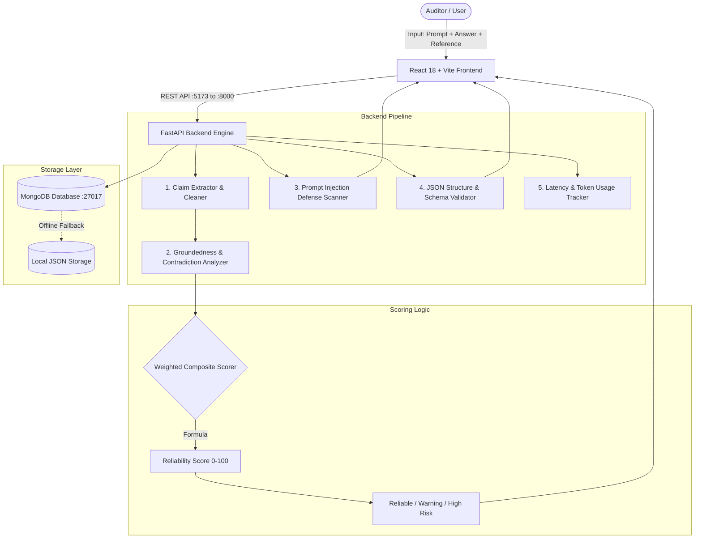

# TrustLens AI – Intelligent AI Response Reliability Auditor

[](https://opensource.org/licenses/MIT)
[](https://fastapi.tiangolo.com)
[](https://react.dev)
[](https://vitejs.dev)
[](https://tailwindcss.com)
[](https://www.mongodb.com)

> **Academic Level:** Undergraduate Engineering Mini-Project  
> **Repository:** [https://github.com/yadavcmeghasyam/project](https://github.com/yadavcmeghasyam/project)  
> **Topic:** Generative AI Quality Assurance, Grounding Verification, Hallucination Auditing, and Input Defense  

---

## 1. Problem Statement

Large Language Models (LLMs) are widely used in conversational assistants, search summarization, code generation, and automated decision-making. However, their probabilistic next-token prediction mechanism introduces critical reliability vulnerabilities:

1. **Hallucinations & Fabrications:** Generating plausible-sounding facts, bogus dates, or fake statistics that have no basis in ground-truth documentation.
2. **Factual Contradictions:** Directly asserting claims that conflict with verified reference sources (e.g., inverted scientific constants or contradictory numbers).
3. **Adversarial Prompt Injection:** Vulnerability to instruction override directives (*"ignore previous instructions"*), jailbreak personas (*DAN, Developer Mode*), and system prompt disclosure attacks.
4. **Structured Format Drift:** Inability to reliably adhere to strict JSON schemas, resulting in runtime parse failures in automated downstream pipelines.
5. **Lack of Transparent Explainability:** Traditional black-box evaluations fail to explain *why* an AI answer is considered untrustworthy.

**TrustLens AI** solves this problem by providing an automated, transparent, explainable reliability auditing system that decomposes responses into discrete factual claims, verifies each against reference documents, scans for prompt attacks, and calculates a documented trust index.

> **System Scope Notice:**  
> TrustLens AI provides groundedness verification and inconsistency detection against user-provided reference documents. It does not claim to detect every conceivable hallucination or guarantee absolute ontological truth.

---

## 2. Main Features

- 📊 **Executive Dashboard:** Live KPI metrics (Total Evaluated, Reliable, Warnings, High-Risk, Average Score) and score distribution frequency charts powered by Recharts.
- 🛡️ **Answer Reliability Checker:** Comprehensive auditing workbench that decomposes generated answers, computes an objective 0–100 reliability score, flags contradictions, and calculates latency/token metrics.
- 🔍 **Hallucination Risk Analyzer:** Evaluates claim-level groundedness, categorizing each assertion as `Supported`, `Partially Supported`, `Unsupported`, or `Contradicted`, paired with direct reference grounding citations.
- ⚡ **Prompt Injection Defense Tester:** Detects adversarial override commands, jailbreak personas, structural tag spoofing, and system prompt extraction queries with defensive mitigation advice.
- 🧩 **JSON Output & Schema Validator:** Validates JSON syntax with exact line and column error indicators, checks required fields, and verifies data types (`string`, `integer`, `boolean`, `array`, `object`).
- ⚖️ **Side-by-Side Model Comparison:** Benchmarks two candidate models simultaneously on the same prompt and reference document, declaring a head-to-head winner with a comparative chart.
- 📜 **Audit History & Records:** Full persistence with search, filter, drilldown inspection, and deletion, powered by MongoDB with a zero-friction local storage fallback.
- ⚙️ **System Diagnostics & Settings:** Live runtime state, storage connection indicator, and transparent documentation of scoring formulas.

---

## 3. Technology Stack

| Layer | Technology | Version | Purpose |
| :--- | :--- | :--- | :--- |
| **Frontend Framework** | React.js | 18.3.1 | Component-driven responsive user interface |
| **Build & Tooling** | Vite | 5.2.11 | High-speed development server and optimized production bundler |
| **Styling** | Tailwind CSS | 3.4.3 | Responsive modern SaaS dark-mode interface |
| **Visualizations** | Recharts | 2.12.7 | Interactive score distribution and comparison charts |
| **Icons** | Lucide React | 0.363.0 | Modern SVG iconography |
| **Backend Framework** | FastAPI (Python) | 0.162.2 | High-performance asynchronous REST API |
| **Data Validation** | Pydantic v2 | 2.14.3 | Strict request/response modeling and schema validation |
| **Server Engine** | Uvicorn | 0.54.0 | High-throughput ASGI server |
| **Database** | MongoDB / Motor | 7.0 / 3.7.1 | Asynchronous document persistence with automatic local fallback |
| **AI Integration** | Google Gemini / OpenAI | Optional | LLM semantic comparison with built-in rule-based fallback |
| **Containerization** | Docker & Docker Compose | 3.8 | Multi-container local or cloud deployment |

---

## 4. Architecture & Data Flow



---

## 5. Project Folder Structure

```text
trustlens-ai/
├── backend/
│   ├── app/
│   │   ├── database/
│   │   │   ├── __init__.py
│   │   │   ├── mongo.py              # MongoDB manager with automatic local demo fallback
│   │   │   └── local_evaluations.json # Local persistent store for demo mode
│   │   ├── models/
│   │   │   ├── __init__.py
│   │   │   └── schemas.py            # Pydantic schemas for requests, responses, claims
│   │   ├── routes/
│   │   │   ├── __init__.py
│   │   │   ├── comparison.py         # POST /api/compare-models
│   │   │   ├── dashboard.py          # GET /api/dashboard/stats & /api/settings/status
│   │   │   ├── evaluate.py           # POST /api/evaluate
│   │   │   ├── hallucination.py      # POST /api/analyze-hallucination
│   │   │   ├── history.py            # GET, DELETE /api/history
│   │   │   ├── injection.py          # POST /api/test-prompt-injection
│   │   │   └── json_validator.py     # POST /api/validate-json
│   │   ├── services/
│   │   │   ├── __init__.py
│   │   │   ├── claim_extractor.py    # Natural language sentence and claim chunker
│   │   │   ├── hallucination_engine.py# Grounding coverage, synonym expansion & contradictions
│   │   │   ├── injection_engine.py   # Pattern catalog for jailbreak and override attacks
│   │   │   ├── json_engine.py        # Syntax error locator with line/col diagnostics
│   │   │   ├── llm_service.py        # Gemini/OpenAI API integration with demo fallback
│   │   │   └── metrics_engine.py     # Latency, token estimation & pricing model
│   │   ├── config.py                 # Pydantic settings loading from .env
│   │   └── main.py                   # FastAPI application initialization & middleware
│   ├── .env.example                  # Environment configuration template
│   ├── Dockerfile                    # Containerization for backend
│   ├── requirements.txt              # Backend Python dependencies
│   ├── run.py                        # Standalone server launcher: python run.py
│   └── test_api.py                   # Automated test script for all endpoints
│
├── frontend/
│   ├── src/
│   │   ├── components/
│   │   │   ├── ClaimCard.jsx         # Card displaying claim assertion and reference evidence
│   │   │   ├── Navbar.jsx            # Top navigation header
│   │   │   ├── SampleDataPicker.jsx  # One-click realistic demo presets
│   │   │   ├── ScoreBadge.jsx        # Status pill (Reliable, Warning, High Risk)
│   │   │   ├── Sidebar.jsx           # Dark navigation sidebar with active indicators
│   │   │   └── StatCard.jsx          # KPI card with gradient glow
│   │   ├── pages/
│   │   │   ├── Dashboard.jsx         # Main analytics and score distribution
│   │   │   ├── EvaluationHistory.jsx # Searchable evaluation records & inspection panel
│   │   │   ├── HallucinationAnalyzer.jsx # Claim breakdown & hallucination rate meter
│   │   │   ├── JsonValidator.jsx     # Line-by-line syntax diagnostics & schema checks
│   │   │   ├── ModelComparison.jsx   # Side-by-side model comparison with Recharts
│   │   │   ├── PromptInjectionTester.jsx # Defensive adversarial prompt scanner
│   │   │   ├── ReliabilityChecker.jsx# Core auditor workbench
│   │   │   └── Settings.jsx          # Diagnostics, environment docs & formula guide
│   │   ├── services/
│   │   │   └── api.js                # Centralized Fetch API abstraction
│   │   ├── App.jsx                   # Tab routing & state controller
│   │   ├── index.css                 # Tailwind directives & custom scrollbars
│   │   └── main.jsx                  # React application entry point
│   ├── package.json                  # Dependencies (React, Vite, Recharts, Lucide)
│   ├── tailwind.config.js            # Tailwind custom color theme
│   ├── postcss.config.js             # PostCSS setup
│   ├── vite.config.js                # Vite development server and API proxy setup
│   └── Dockerfile                    # Containerization for frontend
│
├── .env.example                      # Root configuration template
├── .gitignore                        # Comprehensive security and build ignore rules
├── docker-compose.yml                # Multi-service container orchestrator
├── LICENSE                           # MIT License
└── README.md                         # Complete project documentation
```

---

## 6. Installation & Execution Instructions

### Prerequisites
- Python 3.10 or higher
- Node.js 18 or higher (with npm)
- *(Optional)* MongoDB 6+ running locally or in Docker

### Terminal 1: Launch Backend Server (FastAPI)

```powershell
# Navigate to the backend directory
cd "backend"

# (Optional) Create and activate a Python virtual environment
python -m venv venv
.\venv\Scripts\Activate.ps1

# Install required Python dependencies
python -m pip install -r requirements.txt

# Start the FastAPI server
python run.py
```
- **Backend Server:** [http://127.0.0.1:8000](http://127.0.0.1:8000)
- **Interactive Swagger Documentation:** [http://127.0.0.1:8000/docs](http://127.0.0.1:8000/docs)

---

### Terminal 2: Launch Frontend Application (React + Vite)

```powershell
# In a new PowerShell window, navigate to the frontend directory
cd "frontend"

# Install frontend dependencies
npm install

# Start the Vite development server
npm run dev
```
- **Web Application URL:** [http://localhost:5173](http://localhost:5173)

---

## 7. MongoDB Configuration & Demo Mode

TrustLens AI includes a **zero-friction persistence engine**:

1. **When MongoDB is Running:**  
   The application automatically connects to `mongodb://localhost:27017` and stores audits in the `trustlens_db` database across `evaluations`, `evaluation_metrics`, and `settings` collections.
2. **When MongoDB is Offline (Demo Mode):**  
   If MongoDB is not installed or the service is stopped, TrustLens seamlessly falls back to a local JSON database at `backend/app/database/local_evaluations.json`. The user interface displays `Storage: Local Demo DB` and all features (saving, searching, deleting, dashboard charts) continue working without error.

---

## 8. Docker Deployment

To launch the complete application stack (Frontend, Backend, and MongoDB) with Docker:

```powershell
docker-compose up --build
```
- Web Application: `http://localhost:5173`
- API Server: `http://localhost:8000`
- MongoDB: `localhost:27017`

---

## 9. API Documentation

| Method | Endpoint | Description | Request Body / Parameters |
| :--- | :--- | :--- | :--- |
| `GET` | `/health` | Health check & active storage engine | None |
| `GET` | `/api/dashboard/stats` | Aggregated metrics, distribution, recent audits | None |
| `POST` | `/api/evaluate` | Evaluates answer groundedness and returns full report | `{ prompt, ai_answer, reference_text, model_name }` |
| `POST` | `/api/analyze-hallucination` | Claim-by-claim verification & evidence matching | `{ ai_answer, reference_text }` |
| `POST` | `/api/test-prompt-injection` | Defensive injection and jailbreak pattern audit | `{ prompt, sample_response }` |
| `POST` | `/api/validate-json` | JSON syntax, schema, and type validation | `{ json_input, required_keys, expected_types }` |
| `POST` | `/api/compare-models` | Head-to-head evaluation of two candidate answers | `{ prompt, reference_text, model_a_name, model_a_answer, model_b_name, model_b_answer }` |
| `GET` | `/api/history` | Fetches saved audit history with search and limit | `?search=keyword&limit=50` |
| `GET` | `/api/history/{id}` | Inspects a single evaluation record by ID | Path parameter: `id` |
| `DELETE`| `/api/history/{id}` | Deletes an evaluation record | Path parameter: `id` |
| `GET` | `/api/settings/status` | Non-sensitive system configuration state | None |

---

## 10. Testing Instructions

### Automated Backend Tests
Run the comprehensive automated test suite verifying all 8 core API capabilities:

```powershell
cd backend
python test_api.py
```

**Expected Verification Output:**
```text
[1] Testing Health Endpoint... -> Passed (Status: healthy)
[2] Testing Dashboard Stats... -> Passed (Total Evaluations verified)
[3] Testing Evaluation (Grounded)... -> Passed (Score: 100.0, Risk Level: Reliable)
[4] Testing Evaluation (Contradiction)... -> Passed (Contradiction detected, Risk Level: High Risk)
[5] Testing Prompt Injection Tester... -> Passed (Threat Level: Critical, Risk Score: 80.0)
[6] Testing JSON Validator... -> Passed (Valid syntax, missing key detected)
[7] Testing Model Comparison... -> Passed (Winner declared with score delta)
[8] Testing Evaluation History... -> Passed (Records retrieved successfully)

ALL BACKEND AUDIT TESTS PASSED SUCCESSFULLY!
```

### Frontend Manual Verification
1. Open `http://localhost:5173`.
2. Click **"New Evaluation"** or navigate to **Reliability Checker**.
3. Click the preset button **"✓ Grounded / Reliable"** and hit **Run Reliability Audit**. Verify that the score shows `100/100` with green `Supported` badges.
4. Click the preset button **"✕ Contradicted / Hallucination"** and run the audit. Verify that the score drops, a `Contradicted` badge appears in red, and the contradiction warning is displayed.
5. Navigate to **Prompt Injection Tester**, click **"Instruction Override"**, and test. Verify that a Critical threat level is reported with defensive advice.
6. Navigate to **JSON Validator**, click **"Syntax Error"**, and verify line/column highlighting.

---

## 11. Screenshots Section

When compiling your project report, include screenshots of each key interface:

- **Screenshot 1: Executive Dashboard** (`/`)  
  *Displays summary KPI cards (Total Evaluated, Reliable, Warnings, High-Risk, Average Score) and the score distribution chart.*
- **Screenshot 2: Answer Reliability Checker** (`/reliability`)  
  *Shows the input interface, composite score gauge, claim assertion cards, grounding citations, and latency/token usage.*
- **Screenshot 3: Hallucination Risk Analyzer** (`/hallucination`)  
  *Displays claim-by-claim groundedness evidence and the overall hallucination rate bar.*
- **Screenshot 4: Prompt Injection Tester** (`/injection`)  
  *Shows detected adversarial signatures (`ignore previous instructions`), threat scoring, and defensive mitigation recommendations.*
- **Screenshot 5: JSON Output Validator** (`/json`)  
  *Demonstrates syntax error detection, line/column pointers, missing keys, and schema type verification.*
- **Screenshot 6: Model Comparison View** (`/comparison`)  
  *Shows Model A vs Model B side-by-side with delta ($\Delta$) scoring and a comparative Recharts bar chart.*
- **Screenshot 7: Evaluation History** (`/history`)  
  *Displays the searchable audit record list with the detailed inspection drawer open.*
- **Screenshot 8: Interactive Swagger API Documentation** (`http://127.0.0.1:8000/docs`)  
  *Demonstrates all OpenAPI-compliant REST endpoints.*

---

## 12. Future Enhancements

1. **ChromaDB Vector Retrieval:** Integrate local vector embeddings for semantic document retrieval across large multi-page PDF reference manuals.
2. **Small Language Model (SLM) Classifier:** Train a lightweight local model (e.g. Phi-3 or Gemma-2B) specifically fine-tuned for Natural Language Inference (NLI) contradiction detection.
3. **Multi-Lingual Claim Chunking:** Extend the rule-based chunker to support cross-lingual semantic claim verification in Spanish, French, Hindi, and German.
4. **CI/CD Quality Guardrail:** Package TrustLens AI as a GitHub Action or CLI pre-deployment check to audit model responses during automated integration testing.

---

## 13. License

This project is licensed under the **MIT License** — see the [LICENSE](LICENSE) file for details.
